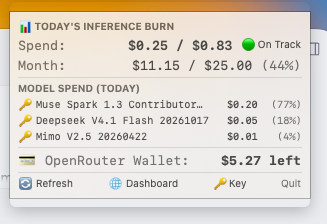

# peek-api ⚡

A glanceable macOS menu bar companion for tracking real-time AI inference spending, BYOK (Bring Your Own Key) routing, and daily budget pacing on [OpenRouter](https://openrouter.ai).

<p align="center">
  
</p>

---

## Why peek-api?

Running autonomous harnesses, multi-agent workflows, or coding assistants (Cursor, Cline, custom LLM scripts) often brings **spend anxiety and context switching**. To check daily burn or model usage, developers repeatedly switch to the browser, log in to OpenRouter, and decipher dashboards.

`peek-api` solves this by giving you ambient, real-time awareness directly in your menu bar.

### Core Value
* **Glanceable Burn Rate:** Daily spend is always visible in the macOS menu bar (`⚡ $0.25 today`).
* **Real-Time Analytics:** Powered by OpenRouter's `analytics/query` API rather than delayed batch activity snapshots.
* **Local Timezone Aware:** Aligns spend boundaries with your machine's local calendar day (e.g. SGT / GMT+8) instead of forcing UTC midnight cuts.
* **Unified Cost (BYOK & Wallet):** Tracks both OpenRouter credit deductions (`⚡`) and direct upstream provider costs (`🔑` Google, DeepSeek, Xiaomi, Meta, etc.).
* **Budget Pacing:** Evaluates daily inference burn against a configurable monthly target ($25/mo ceiling) with visual status indicators:
  - 🟢 **On Track (< $0.80):** Under target daily pacing.
  - 🟡 **Pacing Warning ($0.80 – $1.50):** Borrowing against future days.
  - 🔴 **High Burn (> $1.50):** Runaway loop or heavy unexpected load.
* **Native macOS Feel:** Designed in SwiftUI matching native macOS Control Center card styling, zero webviews, zero heavy dependencies.

---

## Quickstart

### Prerequisites
* macOS 13.0 (Ventura) or later
* Swift 5.9+ / Xcode Command Line Tools
* An [OpenRouter Management Key](https://openrouter.ai/settings/keys) (`sk-or-v1-...`)

### Build & Run from Source

```bash
# Clone the repository
git clone https://github.com/pigarmahdar/peek-api.git
cd peek-api

# Run the app
swift run peek-api
```

To build an optimized release binary:
```bash
swift build -c release
open .build/release/peek-api
```

---

## Configuration

`peek-api` requires an OpenRouter Management Key (`sk-or-v1-...`) to query analytics and wallet balances. You can configure it in any of the following ways:

1. **In-App (Recommended):** Click **Key** in the menu bar popover and paste your key. It is saved locally to `~/.config/peek-api/config.json`.
2. **Environment Variable:**
   ```bash
   export OPENROUTER_MANAGEMENT_KEY="sk-or-v1-..."
   ```
3. **Local `.env` File:**
   ```bash
   OPENROUTER_MANAGEMENT_KEY="sk-or-v1-..."
   ```
4. **Password Manager CLI (e.g. Bitwarden):**
   ```bash
   export OPENROUTER_KEY_COMMAND="bw get password openrouter-management"
   ```

---

## Architecture

* **`Sources/PeekAPICore`**: Pure Swift library containing:
  - `OpenRouterClient`: Networking layer for `credits` and real-time `analytics/query` endpoints with local timezone boundary calculation.
  - `SpendEngine`: State manager with Combine-driven polling, pacing thresholds, and formatting.
  - `KeyResolver`: Multi-tier secret resolver (Env -> `.env` -> CLI command -> config file).
* **`Sources/PeekAPI`**: Native SwiftUI menu bar application using `MenuBarExtra`.
* **`Tests/PeekAPICheck`**: Self-contained regression test suite verifying decoding, BYOK detection, threshold math, and timezone alignment.

### Running Self-Checks

```bash
swift run peek-check
```

---

## License

[MIT](LICENSE) © 2026 Pigarm Ahdar
