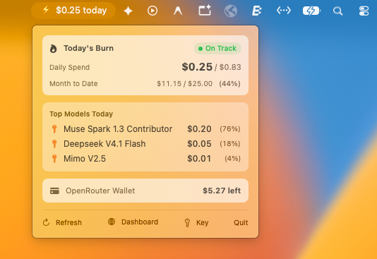

# peek-api ⚡

A glanceable macOS menu bar companion for tracking real-time AI inference spending, BYOK (Bring Your Own Key) routing, and daily budget pacing on [OpenRouter](https://openrouter.ai).

<p align="center">
  
</p>

---

## Why peek-api?

Running autonomous harnesses, multi-agent workflows, or coding assistants (Cursor, Cline, custom LLM scripts) often brings **spend anxiety and context switching**. To check daily burn or model usage, developers repeatedly switch to the browser, log in to OpenRouter, and decipher dashboards.

`peek-api` solves this by giving you ambient, real-time awareness directly in your menu bar.

### Core Value
* **Glanceable Burn Rate:** Daily spend is always visible in the macOS menu bar (`⚡ $0.25 today`).
* **Real-Time Analytics:** Powered by OpenRouter's `analytics/query` API rather than delayed batch activity snapshots.
* **Local Timezone Aware:** Aligns spend boundaries with your machine's local calendar day (e.g. SGT / GMT+8) instead of forcing UTC midnight cuts.
* **Unified Cost (BYOK & Wallet):** Tracks both OpenRouter credit deductions (`⚡`) and direct upstream provider costs (`🔑` Google, DeepSeek, Xiaomi, Meta, etc.).
* **Dynamic Model Pricing on Hover:** Instant glanceable aggregate input and output rates per 1M tokens when hovering over any top model in the popover.
* **Spikeguard Runaway & Surge Protection:** Detects rapid inference burn velocity (> $0.75 in a sync interval) and overnight daemon storms upon waking from macOS sleep, alerting you with native notifications and menu bar flags (`⚠️`) before runaway loops drain capital.
* **Dynamic Budget & Pacing:** Evaluates daily inference burn against a configurable monthly target (default $25/mo) with active calendar-month rate math (`Monthly Budget / Days in Month`):
  - 🟢 **On Track (≤ 1.0× Daily Rate):** Normal consumption within expected daily pacing.
  - 🟡 **Pacing Warning (> 1.0× Daily Rate):** Daily spend exceeding expected rate (borrowing against future days).
  - 🔴 **High Burn (> 3.0× Daily Rate):** Heavy daily spike or runaway inference loop.
* **Native macOS Feel:** Designed in SwiftUI matching native macOS Control Center card styling, zero webviews, zero heavy dependencies.

---

## Quickstart

### Prerequisites
* macOS 13.0 (Ventura) or later
* Swift 5.9+ / Xcode Command Line Tools
* An [OpenRouter Management Key](https://openrouter.ai/settings/keys) (`sk-or-v1-...`)

### Build & Run from Source

```bash
# Clone the repository
git clone https://github.com/pigarmahdar/peek-api.git
cd peek-api

# Run the app
swift run peek api
```

### Launch at Login (Persistent Ambient Monitoring)

Activate the app once and leave it alone across macOS reboots:

```bash
# Enable autostart on macOS login
swift run peek api login on

# Check current status
swift run peek api login status

# Disable autostart
swift run peek api login off
```
You can also toggle **Launch at Login** at any time by clicking **Settings** (⚙️) in the menu bar popover.

To build an optimized release binary:
```bash
swift build -c release
open .build/release/peek
```

---

## Configuration

### 1. OpenRouter Management Key

`peek-api` requires an OpenRouter Management Key (`sk-or-v1-...`) to query analytics and wallet balances. You can configure it in any of the following ways:

1. **In-App (Recommended):** Click **Settings** (⚙️) in the menu bar popover and paste your key. It is saved locally to `~/.config/peek-api/config.json`.
2. **Environment Variable:**
   ```bash
   export OPENROUTER_MANAGEMENT_KEY="sk-or-v1-..."
   ```
3. **Local `.env` File:**
   ```bash
   OPENROUTER_MANAGEMENT_KEY="sk-or-v1-..."
   ```
4. **Password Manager CLI (e.g. Bitwarden):**
   ```bash
   export OPENROUTER_KEY_COMMAND="bw get password openrouter-management"
   ```

### 2. Monthly Budget & Pacing Target

You can configure your monthly spending ceiling to match your personal or team allowance ($10/mo to $500+/mo):

* **In-App:** Click **Settings** (⚙️) in the menu bar popover, edit the **Monthly Budget Target** ($) field, and click **Save Budget**.
* **Direct JSON:** Add or update `"monthly_budget_target"` in `~/.config/peek-api/config.json`:
  ```json
  {
    "key": "sk-or-v1-...",
    "monthly_budget_target": 25.0,
    "spikeguard_threshold": 0.75
  }
  ```

#### Pacing Thresholds
Daily pacing rates dynamically adapt based on the number of days in the active calendar month (28, 29, 30, or 31):
* **Target Daily Rate** = `Monthly Budget / Days in Month` (e.g., $25.00 / 30 = $0.83/day)
* 🟡 **Pacing Warning:** Today's spend exceeds `1.0× Target Daily Rate` (>$0.83)
* 🔴 **High Burn Alert:** Today's spend exceeds `3.0× Target Daily Rate` (>$2.50)

### 3. Spikeguard Runaway Protection

Spikeguard actively monitors spend velocity to stop runaway loops (e.g. repeated tool-call failures or retry storms) before they drain capital:

* **Real-time Velocity:** Compares spend between 5-minute sync intervals. If spend increases by $\ge \$0.75$, `peek-api` triggers a macOS notification banner, flags the culprit model, and changes the menu bar status to `⚠️ $X.XX today`.
* **Wake-from-Sleep Delta Catch:** Hooks directly into macOS wake events (`didWakeNotification`) to audit spend incurred while your laptop was asleep or docked in DarkWake, immediately surfacing any overnight storms.
* **Smart Cooldown & Rollover Safety:** Automatically suppresses repeat notifications for 30 minutes during intentional heavy batch runs, and cleanly skips midnight day rollovers.
* **Custom Threshold:** Override the default `$0.75` trigger by setting `"spikeguard_threshold"` in `~/.config/peek-api/config.json`.

---

## Verification

Run the built-in self-check regression test suite:

```bash
swift run peek-check
```

---

## License

[MIT](LICENSE) © 2026 Pigar Mahdar
